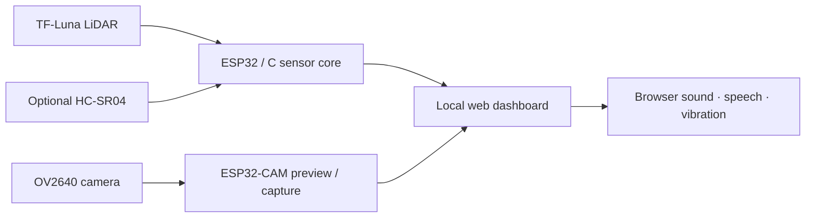

# Semicolon

**Where syntax meets sight.** An embedded assistive-device prototype exploring
obstacle awareness and Indian currency recognition for people who are blind or
have low vision.

[](https://github.com/nimaldanyathk/Semicolon-Embedded-C-Project/actions/workflows/ci.yml)
[](LICENSE)
[](platformio.ini)

[Get started](docs/setup.md) · [Wiring](docs/hardware.md) ·
[Architecture & API](docs/architecture.md) · [Currency experiments](docs/currency.md) ·
[Testing](docs/testing.md)

## Overview

Semicolon began as a C programming project combining an ESP32-CAM, TF-Luna LiDAR,
HC-SR04 ultrasonic sensing, and camera-based currency experiments. The repository
now provides a shared **C sensor core**, explicit **C++ firmware targets**, and
a separate **C/OpenCV desktop demo**, with reproducible builds and regression tests.

The navigation firmware reads obstacle distance, serves a local browser
dashboard, and offers browser-based beep, speech, and phone-vibration alerts.
An ESP32-CAM can also provide JPEG capture and an optional live preview.

> **Project status:** educational research prototype. Hardware behavior and
> assistive-use effectiveness still require bench and user testing. The original
> trained currency model and image dataset are unavailable; currency recognition
> is an optional integration path, not a working feature of the default build.

## Capabilities

| Component | What is implemented | Boundary |
| --- | --- | --- |
| Distance sensing | TF-Luna UART parser, checksum/quality checks, stale-data expiry | Requires correctly wired UART-mode sensor |
| Backup sensing | Optional HC-SR04 fallback when LiDAR is invalid or stale | Disabled by default; requires echo level shifting |
| Accessible dashboard | Distance/source status, labeled controls, keyboard focus, configurable alerts | Browser must remain visible and connected |
| Feedback | User-enabled beep, speech, and phone vibration | Browser/device support varies; no external actuator driver |
| Camera | QVGA JPEG capture and isolated MJPEG stream | AI Thinker ESP32-CAM; one streaming client |
| Connectivity | Bounded station connection and optional protected fallback AP | Credentials configured locally; trusted networks only |
| Embedded currency | Edge Impulse camera adapter with checked reusable buffers | Trained model export missing; excluded from default builds |
| Desktop currency | OpenCV template matching for ₹100/₹200/₹500 reference folders | Local images required; heuristic demonstration |

Navigation and currency inference are separate firmware builds. Integrated mode
switching, physical haptics, and onboard speech are future work.

## System at a glance



## Quick start

1. Follow the [wiring guide](docs/hardware.md). The revised ESP32-CAM ultrasonic
   ECHO pin is **GPIO15**, and the LiDAR RX wire is not connected.
2. Install the pinned PlatformIO Core and create your local configuration:

   ```sh
   git clone https://github.com/nimaldanyathk/Semicolon-Embedded-C-Project.git
   cd Semicolon-Embedded-C-Project
   python3 -m venv .venv
   source .venv/bin/activate
   python -m pip install platformio==6.1.19
   cp include/config.example.h include/config.h
   ```

3. Edit `include/config.h` with your Wi-Fi credentials, or set an 8–63 character
   fallback AP password. This file is ignored by Git.
4. Build and upload:

   ```sh
   pio run -e navigation-esp32cam
   pio run -e navigation-esp32cam -t upload
   pio device monitor -b 115200
   ```

5. Open the printed `http://DEVICE_IP/` URL and select **Enable alerts**.

For an ESP32 Dev Module use `navigation-esp32dev`. With no credentials configured,
serial sensing still runs and no open AP is created. See the
[complete setup guide](docs/setup.md) for Windows, ESP32-CAM bootloader wiring,
optional ultrasonic sensing, and troubleshooting.

## Repository layout

```text
.
├── firmware/
│   ├── navigation/          # Sensor firmware, HTTP endpoints, accessible web UI
│   ├── currency/            # Optional Edge Impulse model adapter
│   └── shared/              # AI Thinker camera configuration
├── lib/semicolon_core/      # Portable C11 parser and distance selection
├── desktop/currency_detection/ # C entry point and OpenCV C++ adapter
├── include/                # Safe defaults and local configuration template
├── tests/                  # C, C++, and JavaScript regression tests
├── tools/                  # Repository checks
├── docs/                   # Wiring, setup, architecture, migration, testing
├── .github/workflows/      # Host checks and firmware build matrix
├── CMakeLists.txt          # Host tests and optional desktop demo
└── platformio.ini          # Pinned firmware environments
```

Looking for an older sketch? See the [migration map](docs/migration.md).
Historical versions remain in Git; generated objects and duplicate ZIP/source
copies are no longer part of the maintained tree.

## Development and verification

```sh
cmake -S . -B build
cmake --build build
ctest --test-dir build --output-on-failure
node --test tests/dashboard.test.js
python3 tools/check_repository.py
```

Enable `-DSEMICOLON_DESKTOP=ON` when OpenCV 4 is installed. CI runs host tests
and compiles both navigation boards with ultrasonic sensing on and off. Tests
cover parsing, recovery, freshness, fallback, invalid inputs, and template-matching
edge cases. They do not establish sensor accuracy or currency-recognition quality.
See the [verification guide](docs/testing.md) and [contribution guide](CONTRIBUTING.md).

## Limitations and next steps

- Validate power, sensing, reconnect behavior, camera streaming, and feedback on
  the physical device using the documented bench checklist.
- Recover or retrain the currency model and evaluate it on representative held-out
  banknote and background images before reporting accuracy.
- Design and validate onboard actuator/audio feedback and physical mode switching.
- Evaluate usability with intended users under supervision. Missing readings do
  not mean a clear path; the prototype does not replace an established mobility aid.

## Project team and license

Created by [Nimal Danyath K](https://github.com/nimaldanyathk), with repository
contributions from [NIKHILRAJ2006](https://github.com/NIKHILRAJ2006) and
[Ruthwik9590](https://github.com/Ruthwik9590).

Project code is available under the [MIT License](LICENSE). Retained third-party
example code and optional dependencies have their own notices; see
[third-party notices](THIRD_PARTY_NOTICES.md).
