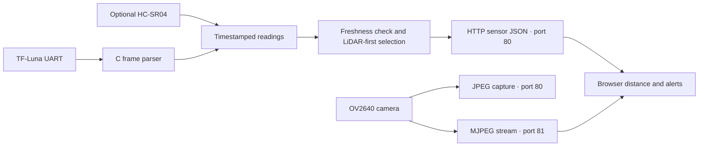

# Architecture and HTTP API

## Components



`lib/semicolon_core` is portable C11, independent of Arduino and networking.
The firmware and OpenCV adapter use C++ because their libraries require it.
The desktop application keeps a C entry point and a documented C ABI.

## Sampling and concurrency

- `loop()` drains up to 512 UART bytes per pass, with a 1 ms scheduler yield.
- The parser retains partial frames, verifies checksums, and searches within
  corrupt frames for the next header.
- Checksum-valid but unreliable readings immediately invalidate the sensor.
  Corrupt/missing frames do not refresh its timestamp.
- Valid samples expire after 1,500 ms. Unsigned timestamp subtraction handles
  the `millis()` rollover; samples must be refreshed within the timeout.
- A FreeRTOS critical section protects reading copies between the loop and
  HTTP task. The camera readiness flag is atomic.
- Optional ultrasonic pulses are bounded to 18 ms; they never run inside an
  HTTP request.
- Each JSON request completes. The browser schedules its next poll 200 ms after
  completion, aborts a request after 1,500 ms, and independently invalidates data
  at 2,000 ms. Effective end-to-end stale detection also includes sensor timeout
  and network latency.

The previous indefinite SSE loop occupied the synchronous HTTP server task.
Bounded polling removes that blockage and supports multiple ordinary dashboard
requests. This is an intentional API change: there is no `/events` endpoint.

## Camera isolation

The stream has a dedicated HTTP task, port 81, and a distinct control port.
It supports one stream client. A mutex protects framebuffer acquisition and
return across capture/stream handlers. Streaming yields between frames, send
timeouts are bounded, and each acquired frame is returned even on failure.
A still capture can return `503` when the camera is busy. Camera failure does
not disable distance telemetry.

## Endpoints

| Method and path | Port | Response |
| --- | --- | --- |
| `GET /` | 80 | Accessible dashboard |
| `GET /app.js`, `GET /style.css` | 80 | Firmware-embedded assets |
| `GET /sensors` | 80 | JSON snapshot, no-store |
| `GET /capture` | 80 | JPEG; registered only after camera startup |
| `GET /stream` | 81 | MJPEG; camera build only |

Example `/sensors` response (illustrative):

```json
{
  "distance_cm": 64,
  "source": "lidar",
  "lidar_cm": 64,
  "ultrasonic_cm": -1,
  "camera": true,
  "uptime_ms": 12000
}
```

Distances are integer centimeters. `-1` means unavailable/invalid/stale.
`source` is `lidar`, `ultrasonic`, or `none`. The selected distance prefers valid,
fresh LiDAR; it falls back to ultrasonic only when LiDAR is unavailable.
`camera` reports camera-server initialization, not ongoing stream health.
`uptime_ms` is a 32-bit unsigned millisecond count and wraps after about 49.7 days.

The old approximate chip-temperature field is removed: it was not an ambient
temperature reading and relied on an undocumented, inconsistently cached API.

## Currency is a separate firmware target

The model adapter captures QVGA JPEG, converts to a reusable PSRAM buffer, resizes
into a separate model-input buffer, and passes bounded RGB pixel reads to Edge
Impulse. It prints model outputs to serial. It does not run simultaneously with
the navigation target and does not implement a physical mode button or speech.
See [currency.md](currency.md) for the missing artifacts and validation boundary.
